

<a href="https://lorenzo0111.me"></a>

 

  

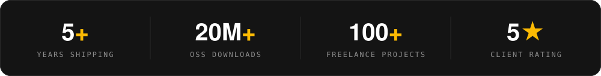

  

<picture>
  <source media="(prefers-color-scheme: dark)" srcset="media/heading-build-dark.svg">
  
</picture>

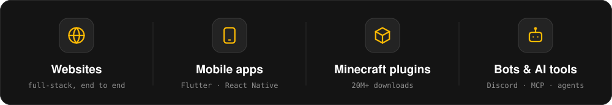

  

<picture>
  <source media="(prefers-color-scheme: dark)" srcset="media/heading-work-dark.svg">
  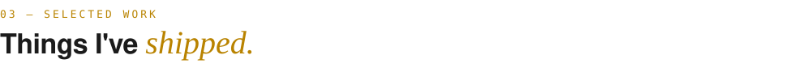
</picture>

<!-- projects:start -->

<a href="https://github.com/Lorenzo0111/QualityArmory">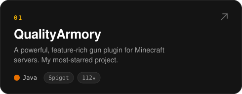</a>
<a href="https://github.com/Lorenzo0111/NextTravel">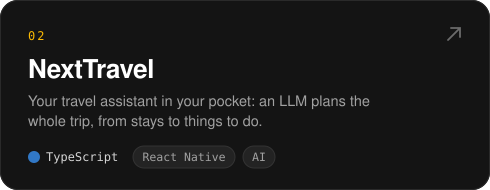</a>
<a href="https://github.com/Lorenzo0111/LISA">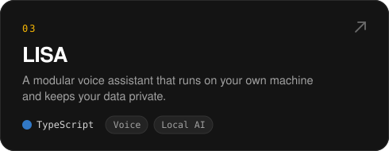</a>
<a href="https://github.com/Lorenzo0111/CreatorDashboard">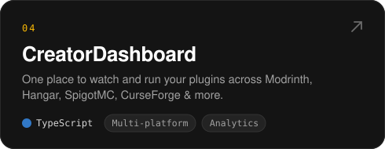</a>
<a href="https://github.com/Lorenzo0111/MultiLang">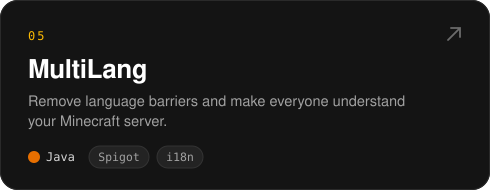</a>
<a href="https://github.com/Lorenzo0111/DownloadTracker">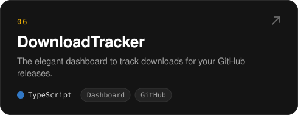</a>

<!-- projects:end -->

<a href="https://lorenzo0111.me/projects">See all projects →</a>

  

<picture>
  <source media="(prefers-color-scheme: dark)" srcset="media/heading-stack-dark.svg">
  
</picture>

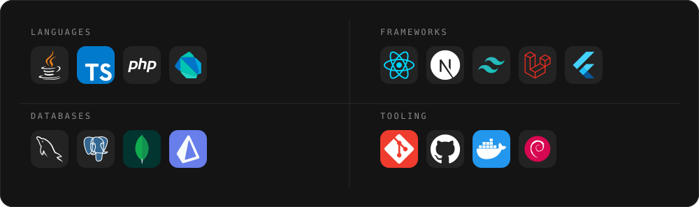

  

<a href="https://lorenzo0111.me/contact">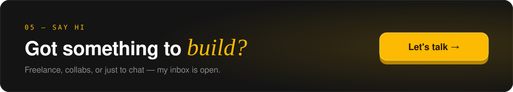</a>

